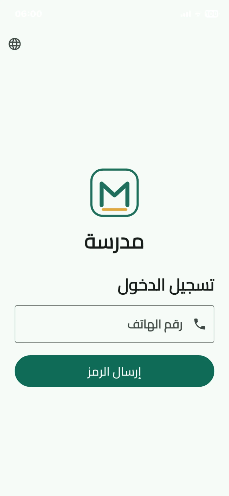
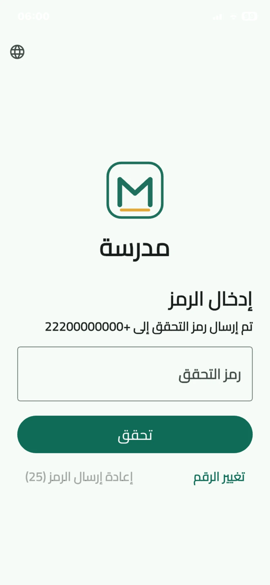
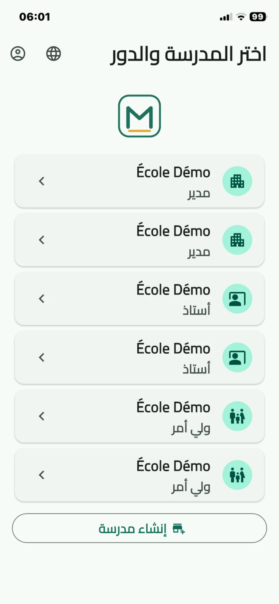
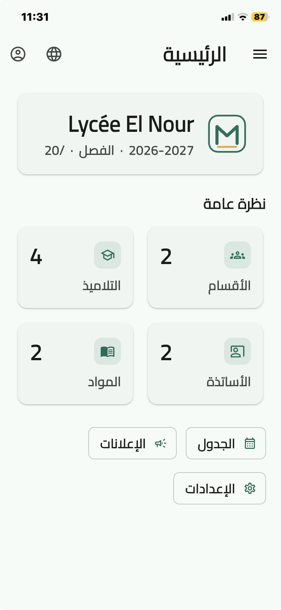
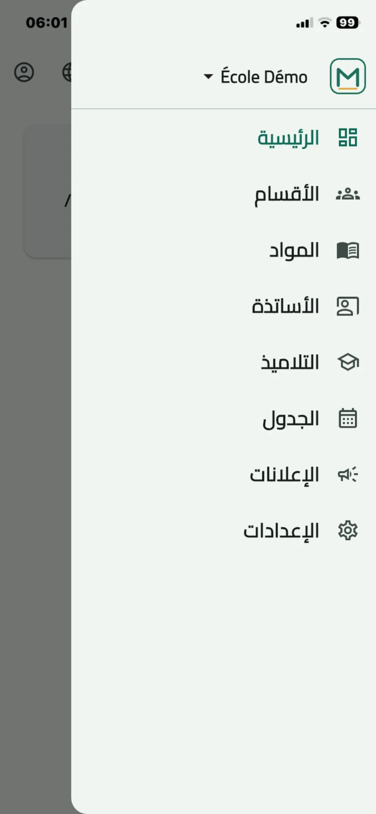
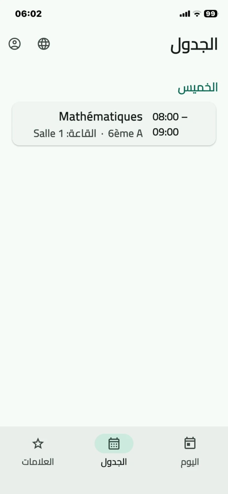
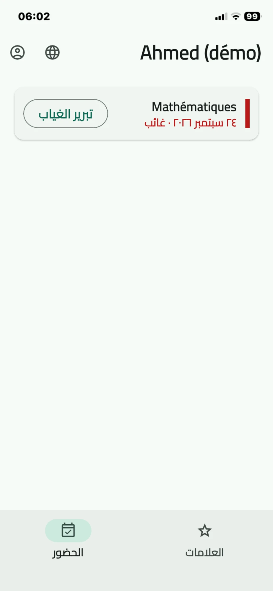

<div align="center">

# مدرسة · Madrasa

### School management & parent-communication platform — built for Mauritania, in one Flutter codebase for Web, iOS & Android.

[](https://flutter.dev)
[](https://supabase.com)
[](#)
[](#)

*A production app connecting schools, teachers and parents — real-time attendance, grades, report cards and announcements. Arabic-first and fully right-to-left.*

</div>

---

## 📖 Overview

**Madrasa** replaces the paper-based follow-up still used in many schools with a single platform where:

- **Directors** set up the school, classes, subjects, teachers, students, timetable and announcements — mostly from a web dashboard.
- **Teachers** record attendance and enter grades in real time, per class session.
- **Parents** follow their children's grades and absences daily, mark absences as excused, and download report cards (bulletins) — helping families intervene early and reduce school dropout.

One codebase serves the **web dashboard** and the **mobile apps**; the UI adapts by screen width, not by platform.

> **Status:** Live web version deployed · iOS app published to the App Store · Android-ready from the same codebase.

---

## 📱 Screenshots

<div align="center">

| Phone login (OTP) | OTP verification | Multi-role / multi-school |
|:---:|:---:|:---:|
|  |  |  |

| Director dashboard | Navigation | Timetable |
|:---:|:---:|:---:|
|  |  |  |

| Parent — attendance & excuse |
|:---:|
|  |

</div>

---

## ✨ Key features

**For the director**
- Create a school with its academic year and term structure (trimester or semester).
- Manage classes, subjects, teachers and students; build the weekly timetable.
- Configure the grading scale (e.g. /20) with **per-class subject coefficients**.
- Send **targeted announcements** (to teachers, to parents, or to both).
- One account can manage **multiple schools**, with an activation gate per school.

**For the teacher**
- Mark attendance per class session (present / absent / late).
- Enter grades in real time, by assessment type (exam, test, homework), each with its **own coefficient**.
- See only their own schedule and assigned classes.

**For the parent**
- Follow each child's grades and attendance — across **multiple children in multiple schools** from a single account.
- Mark an absence as **excused** with a reason.
- Generate and print a **report card (bulletin)** per term or for the whole year, with a weighted average and **class rank**, exported as a localized PDF.

**Platform-wide**
- **Trilingual**: Arabic (default), French, English — with full **RTL** support.
- **Phone-number identity** with OTP sign-in (WhatsApp/SMS) — no passwords for users.
- In-app **account deletion** and a public privacy policy.

---

## 🏗️ Architecture highlights

- **Single Flutter codebase** → Web + iOS + Android, sharing all models and data access. Responsive by width via breakpoints, not platform checks.
- **Supabase backend**: Postgres with **Row-Level Security** as the real security boundary. Phone number is the identity; policies match users to the schools and children they're allowed to see — a parent can never read another child's data.
- **Edge Functions (Deno/TypeScript)** for OTP send/verify (ChinqIT gateway), account deletion and push fan-out. **All secrets live in Supabase env vars — never in the client or the repo.**
- **Passwordless auth**: the client generates a throwaway password on verification, so users only ever enter a phone number and a one-time code.
- **Two-level weighted averaging** for report cards: grades are weighted by assessment coefficient within a subject, then subjects by their per-class coefficient for the overall average and class rank (computed server-side via a `SECURITY DEFINER` RPC that returns only rank — never other students' data).

### Tech stack

| Layer | Technology |
|---|---|
| Frontend | Flutter 3.11, Dart, Material 3, Provider |
| i18n / fonts | Custom trilingual strings, `google_fonts` (Cairo), RTL |
| Backend | Supabase — Postgres, Auth, Row-Level Security, Edge Functions |
| Documents | `pdf` + `printing` (localized report-card PDFs) |
| Auth gateway | ChinqIT (WhatsApp / SMS OTP) |

---

## 🚀 Getting started

```bash
flutter pub get
flutter run        # web, iOS or Android
```

The app ships with sensible defaults, so a bare `flutter run` works. Point it at your own Supabase project with dart-defines:

```bash
flutter run \
  --dart-define=SUPABASE_URL=https://YOUR-PROJECT.supabase.co \
  --dart-define=SUPABASE_ANON_KEY=sb_publishable_xxx
```

Database schema, RLS policies and Edge Functions live under [`supabase/`](supabase/) (migrations + functions). The anon/publishable key is meant to live in client code — RLS is what protects the data.

---

## 👨‍💻 About the Developer

Built by **Oussama Mohamed El Hadi** — a full-stack developer building clean, cross-platform apps for **Web, iOS & Android** with Flutter & Supabase. **Madrasa** is a real, shipped product — from database design and Row-Level Security to a polished, localized UI.

**Available for freelance work.** I build Flutter + Supabase apps from idea to App Store / Play Store — including UI/UX, custom branding, backend and release.

<div align="center">

[](https://www.upwork.com/freelancers/~01825ff64c8093996f?mp_source=share)
[](https://www.upwork.com/freelancers/~01825ff64c8093996f?mp_source=share)
[](https://www.fiverr.com/s/Vrrklkz)
[](https://www.fiverr.com/s/Vrrklkz)
[](mailto:oussama.mohamedelhadi@gmail.com)
[](mailto:oussama.mohamedelhadi@gmail.com)
[](https://github.com/osmsmix)
[](https://github.com/osmsmix)

</div>

> Other shipped apps: Mauri-Citat, PetroTools.

---

<div align="center">
<sub>Built with Flutter & Supabase · Arabic-first · © Madrasa</sub>
</div>
